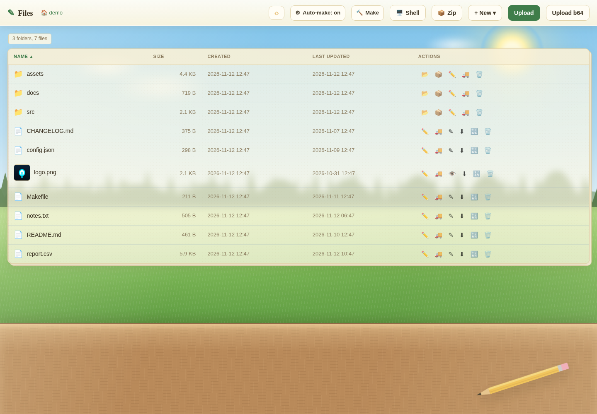
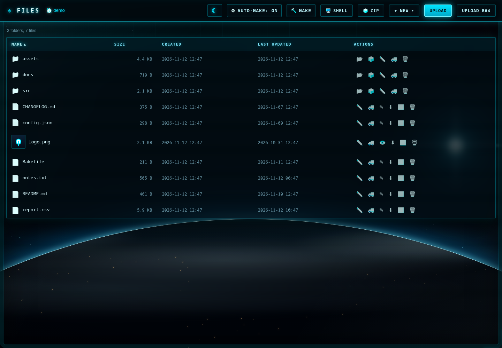

# filemanager.py

> **Disclaimer:** This project is vibe coded — built quickly with AI
> assistance and without formal review or testing for production use. It is
> a toy project and should **not** be used for any production purposes.

A single-file web file manager. Start it in any directory, open the URL in
a browser, and browse, edit, upload, download and run files — no database,
no configuration file, no build step. Everything (backend, HTML, CSS and
JavaScript) lives in one Python file and only needs the standard library.

The screenshots below show the app serving a demo folder with sample
project data.



*Light theme — a summer desk by the window.*



*Dark theme — a space-station window looking down at Earth.*

## Features

### Browsing

- Directory listing with name, size, created time and last-updated time.
- Click a sortable column header to sort; click again to reverse the order.
- Breadcrumb navigation back up the tree.
- Recursive folder sizes, computed in the background.
- Image thumbnails in the listing (requires Pillow; without it you get a
  generic icon).
- Hidden files are shown like any other entry — nothing is filtered out.

### Creating, editing and organising

- Create folders and empty text files.
- Rename, move (with a folder-tree picker) and delete files or folders.
- View images directly in the browser.
- Edit plain-text files in a built-in editor, with selectable line endings
  (`as-is`, `LF`, `CRLF`, `CR`).
- Other file types can be opened in the browser for preview or download.

### Uploading and downloading

- Multi-file upload with a progress bar.
- Base64 upload/download as a workaround for flaky networks.
- Download single files, or the current folder as a ZIP archive.
- Extract ZIP archives into a folder, with an optional delete-after-extract.

### Running commands

- **Run** executable files with optional arguments and a timeout, and see
  the combined stdout/stderr and exit code.
- **Shell** opens a command box that runs arbitrary commands through
  `bash -c` in a chosen working directory, with history and a timeout.
- **Make** runs `make` in the current folder on demand.
- **Automatic make**: when a folder contains a `Makefile`, `make` is run
  automatically after files are edited, uploaded or deleted, and the output
  is shown in a modal. The **Auto-make** toggle in the header disables this
  (the choice is stored in the browser and survives restarts); the manual
  **Make** button always runs regardless of that toggle.
- Any of the three can be disabled entirely at startup with `--no-shell`,
  `--no-run` or `--no-make` (the last one turns off both the automatic
  rebuilds and the manual Make button). Disabled features are hidden in the
  UI and their endpoints refuse requests with a 403 error.

### Themes

- **Light** — a summer day: a translucent paper listing on a desk with a
  pencil, looking out over a grassy field and forest.
- **Dark** — cyan neon cyberpunk aboard a space station: a view over Earth's
  horizon, a distant sun, stars and a subtle station-window frame.
- The initial theme follows the operating system (`prefers-color-scheme`).
- The header toggle switches themes and remembers the choice per browser.
- Shift-click the theme toggle to forget the choice and return to automatic
  system detection.

## Requirements

- Python 3.8 or newer.
- `Pillow` is optional; install it to get image thumbnails.
- `make` is optional; it is only used for automatic or manual make runs.
- `bash` is optional; it is only used by the Shell feature.

No third-party Python packages are required.

## Quick start

```bash
# Serve the current directory on http://127.0.0.1:8000/
python3 filemanager.py

# Serve a specific directory
python3 filemanager.py /path/to/folder

# Bind to all interfaces on a custom port
python3 filemanager.py /path/to/folder --host 0.0.0.0 --port 8080

# Disable shell access, executable execution, and make (auto and manual)
python3 filemanager.py /path/to/folder --no-shell --no-run --no-make
```

Then open the printed URL in your browser.

## Command-line options

| Option | Default | Description |
| --- | --- | --- |
| `root` | current directory | Directory to serve. |
| `--host` | `127.0.0.1` | Address to bind. Use `0.0.0.0` only behind a reverse proxy or firewall. |
| `--port` | `8000` | Port to listen on. |
| `--no-shell` | off | Disable shell access (Shell button and `/api/shell`). |
| `--no-run` | off | Disable execution of executable files (Run button and `/api/run`). |
| `--no-make` | off | Disable make entirely: no automatic rebuilds and no manual Make button (`/api/make`). |

## Security

This is a single-user tool intended for a trusted machine or a protected
network:

- There is **no authentication and no HTTPS**. Anyone who can reach the
  port can read, write, rename and delete files under the served root.
- The **Run** and **Shell** features execute arbitrary commands with the
  permissions of the user running the server. Treat access to this app as
  equivalent to a shell account. To reduce the exposure, start the server
  with `--no-run`, `--no-shell` and/or `--no-make` to remove the command
  execution features entirely.
- The server refuses paths outside the served root, but that is not a
  substitute for access control.
- For remote access, bind to localhost and put the app behind an
  authenticating reverse proxy, or forward the port over SSH.

## Design notes

- **Stateless**: the app serves the directory given on the command line and
  stores no database, config or metadata. UI preferences (theme, auto-make)
  live in the browser's `localStorage`.
- **Single file**: `filemanager.py` embeds the HTML template, CSS and
  JavaScript. The template is read once at startup, so restart the process
  after editing the file.
- **Limits** (adjustable at the top of the file): run output is capped at
  1 MB, the default run timeout is 60 seconds, and the maximum timeout is
  1 hour.
- Uses `ThreadingHTTPServer`, so multiple requests can be handled at once.
- File type detection is extension-based, with UTF-8 assumed for text files.
