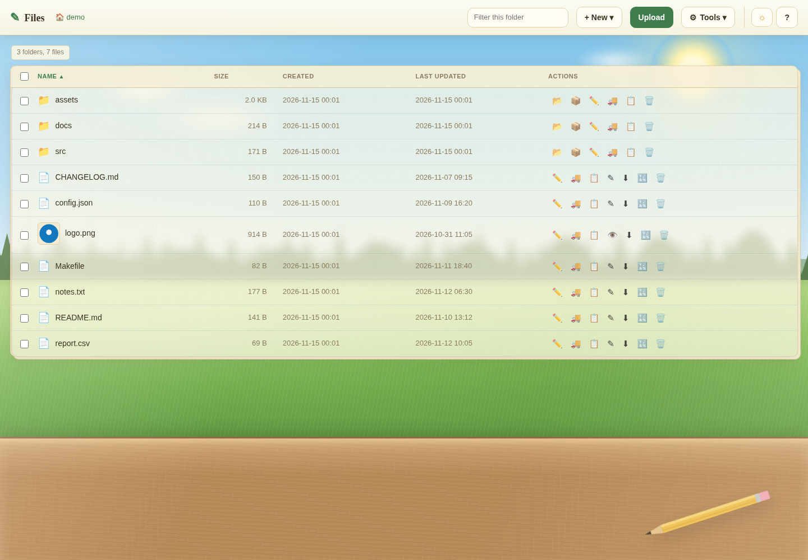
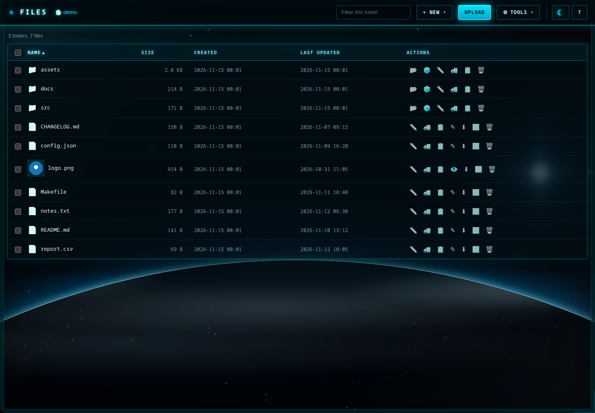

# filemanager.py

> **Disclaimer:** This project is vibe coded — built quickly with AI
> assistance and without formal review or testing for production use. It is
> a toy project and should **not** be used for any production purposes.

A single-file web file manager. Start it in any directory, open the URL in
a browser, and browse, edit, upload, download and run files — no database,
no configuration file, no build step. Everything (backend, HTML, CSS and
JavaScript) lives in one Python file and only needs the standard library.
(`test_filemanager.py` holds the tests; the app never imports it.)

The screenshots below show the app serving a demo folder with sample
project data.



*Light theme — a summer desk by the window.*



*Dark theme — a space-station window looking down at Earth.*

## Features

### Browsing

- Directory listing with name, size, created time and last-updated time.
- Click a sortable column header to sort; click again to reverse the order.
- Breadcrumb navigation back up the tree, plus a filter box that narrows the
  current folder as you type.
- The current folder lives in the URL, so the back button, reloads and pasted
  links all work.
- Recursive folder sizes, computed in the background.
- Image thumbnails in the listing (requires Pillow; without it you get a
  generic icon). SVG previews work either way — the browser draws those.
- Symbolic links are marked with what they point at, and a link that points at
  nothing is labelled `broken`.
- Hidden files are shown like any other entry — nothing is filtered out.
- Very large folders are listed up to a cap (20 000 entries by default) and
  the header says so instead of pretending that is everything.

### Creating, editing and organising

- Create folders and empty text files.
- Rename, move and copy files or folders (both with a folder-tree picker), and
  delete them.
- Tick a few entries to move, copy or delete the whole selection at once.
- View images directly in the browser.
- Edit plain-text files in a built-in editor, with selectable line endings
  (`as-is`, `LF`, `CRLF`, `CR`) and `Ctrl`/`Cmd`+`S` to save.
- Saving refuses to overwrite a file that changed on disk since you opened it
  (a second tab, a make, an outside editor) and offers to reload it instead;
  closing the editor with unsaved changes asks first.
- Other file types can be opened in the browser for preview or download.
- Nothing is ever silently overwritten: a name that exists becomes
  `report (1).pdf`, `report (2).pdf`, and so on.

### Uploading and downloading

- Multi-file upload with a progress bar; three files go up at a time and the
  bar counts bytes, not files.
- Drag files onto the window to upload them to the folder you are looking at
  (drop a folder instead and it tells you to zip it first).
- Uploads keep going to the folder that was open when they started, even if
  you browse elsewhere while they run.
- Base64 upload/download as a workaround for flaky networks; can be
  disabled entirely with `--no-b64` (the buttons disappear and the endpoints
  refuse requests with a 403 error).
- Download single files, or the current folder as a ZIP archive (empty folders
  survive the round trip, and the archive holds one folder rather than a
  spill of files).
- Extract ZIP archives into a folder, with an optional delete-after-extract.
- Downloads are streamed and support `Range` requests and `HEAD`, so a video
  or audio file can be seeked in the browser instead of downloaded first.

### Running commands

- **Run** executable files with optional arguments and a timeout, and see
  the combined stdout/stderr and exit code.
- **Shell** opens a command box that runs arbitrary commands through
  `bash -c` in a chosen working directory, with history and a timeout.
- **Make** runs `make` in the current folder on demand.
- **Automatic make**: when a folder contains a `Makefile`, `make` is run
  automatically after files are edited, uploaded or deleted, and the output
  is shown in a modal. The **Auto-make** toggle in the header disables this
  (the choice is stored in the browser and survives restarts); the manual
  **Make** button always runs regardless of that toggle. A build that finishes
  while another dialog is open waits in a queue instead of replacing it.
- Any of the three can be disabled entirely at startup with `--no-shell`,
  `--no-run` or `--no-make` (the last one turns off both the automatic
  rebuilds and the manual Make button), and the programs they use can be
  changed with `--shell-cmd` and `--make-cmd`.
- `--read-only` turns off every change, including Run, Shell and Make, since
  all three can write anywhere.

### Themes

- **Light** — a summer day: a translucent paper listing on a desk with a
  pencil, looking out over a grassy field and forest.
- **Dark** — cyan neon cyberpunk aboard a space station: a view over Earth's
  horizon, a distant sun, stars and a subtle station-window frame.
- The initial theme follows the operating system (`prefers-color-scheme`).
- The header toggle switches themes and remembers the choice per browser.
- Shift-click the theme toggle to forget the choice and return to automatic
  system detection.

## Requirements

- Python 3.10 or newer.
- `Pillow` is optional; install it to get image thumbnails.
- `make` is optional; it is only used for automatic or manual make runs.
- `bash` is optional; it is only used by the Shell feature.

No third-party Python packages are required.

## Quick start

```bash
# Serve the current directory on http://127.0.0.1:8000/
python3 filemanager.py

# Serve a specific directory
python3 filemanager.py /path/to/folder

# Bind to all interfaces on a custom port
python3 filemanager.py /path/to/folder --host 0.0.0.0 --port 8080

# Browse only: nothing can be created, edited, uploaded, moved, deleted,
# extracted or run
python3 filemanager.py /path/to/folder --read-only

# Disable shell access, executable execution, make (auto and manual)
# and the base64 upload/download workaround
python3 filemanager.py /path/to/folder --no-shell --no-run --no-make --no-b64
```

Then open the printed URL in your browser. Startup also prints the active
modes (read-only or read-write, which shell and make program are used, and
whether thumbnails are available).

## Command-line options

| Option | Default | Description |
| --- | --- | --- |
| `root` | current directory | Directory to serve. |
| `--host` | `127.0.0.1` | Address to bind. Use `0.0.0.0` only behind a reverse proxy or firewall. |
| `--port` | `8000` | Port to listen on. |
| `--read-only` | off | Refuse every change: no creating, editing, uploading, moving, deleting, extracting or running. Browsing, viewing and downloading keep working. |
| `--no-shell` | off | Disable shell access (Shell button and `/api/shell`). |
| `--no-run` | off | Disable execution of executable files (Run button and `/api/run`). |
| `--no-make` | off | Disable make entirely: no automatic rebuilds and no manual Make button (`/api/make`). |
| `--no-b64` | off | Disable the base64 upload/download workaround (`/api/upload64`, `/api/download64`). |
| `--shell-cmd` | `bash` | Program the Shell button passes commands to. |
| `--make-cmd` | `make` | Program used for make (e.g. `gmake`, `ninja`). |
| `--version` | — | Print the version and exit. |

## HTTP API

Everything speaks JSON except the download endpoints, which stream files.
`GET /health` is a small status document for monitors and container health
checks: it reports the version, uptime, served root, whether the server is
read-only, and whether Pillow is available.

| GET | Description |
| --- | --- |
| `/` | The single-page app. |
| `/health` | Status document (silent in the access log). |
| `/api/list?path=` | One folder: entries, totals, symlink targets. |
| `/api/tree?path=` | Folder names only, for the move/copy picker. |
| `/api/text?path=` | File contents, detected line endings, `mtime_us`. |
| `/api/raw?path=` | File inline (supports `Range` and `HEAD`). |
| `/api/download?path=` | File as an attachment. |
| `/api/zip?path=` | Folder streamed as a ZIP archive. |
| `/api/thumbnail/…` | Rendered thumbnail, cached and ETagged. |
| `/api/download64?path=` | File as base64 in JSON. |
| `/api/make/result?job=` | Status of a background make job. |

| POST | Description |
| --- | --- |
| `/api/mkdir?path=`, `/api/newfile?path=` | Create a folder or an empty file. |
| `/api/save?path=` | Write a text file (atomic, optional `if_mtime_us` guard). |
| `/api/delete?path=` | Delete one entry (a symlink is unlinked, not followed). |
| `/api/rename?path=` | Rename, body `{"name": …}`. |
| `/api/move?path=`, `/api/copy?path=` | Move or copy into a folder, body `{"dest": …}`. |
| `/api/foldersize` | Recursive sizes for a list of folders, body `{"paths": […]}`. |
| `/api/upload?path=&filename=` | Raw request body stored as a file. |
| `/api/upload64?path=&filename=` | Base64 in JSON, body `{"data": …}`. |
| `/api/extract?path=` | Extract a ZIP, body `{"dest": …, "delete": …}`. |
| `/api/run?path=` | Execute a file, body `{"args": […], "timeout": …}`. |
| `/api/make?path=` | Run make and wait for the result. |
| `/api/shell` | Run a command, body `{"command": …, "cwd": …, "timeout": …}`. |

## Docker

```bash
docker build -t filemanager .
docker run --rm -p 8000:8000 -v "$PWD:/data" filemanager
# arguments replace the image's defaults, so repeat --host/--port:
docker run --rm -p 8000:8000 -v "$PWD:/data" \
    filemanager /data --host 0.0.0.0 --port 8000 --read-only
```

The image is the Python 3.12-alpine base plus `bash` and `make` (only needed
by the Shell and Make features); Pillow is left out, so thumbnails fall back
to a generic icon — add `py3-pillow` to the `apk add` line to get them. It
runs as an unprivileged user and serves `/data`. Its health check polls
`/health`.

## Security

This is a single-user tool intended for a trusted machine or a protected
network:

- There is **no authentication and no HTTPS**. Anyone who can reach the
  port can read, write, rename and delete files under the served root.
- The **Run** and **Shell** features execute arbitrary commands with the
  permissions of the user running the server. Treat access to this app as
  equivalent to a shell account. To reduce the exposure, start the server
  with `--no-run`, `--no-shell`, `--no-make` or `--read-only`.
- The server refuses paths outside the served root, but that is not a
  substitute for access control.
- Requests are not authenticated, so the app deliberately does not try to be
  a browser-security boundary either: there are no CSRF or `Origin` checks and
  `/api/raw` serves files with their own content type. That is the reverse
  proxy's job.
- For remote access, bind to localhost and put the app behind an
  authenticating reverse proxy, or forward the port over SSH.

## Design notes

- **Stateless**: the app serves the directory given on the command line and
  stores no database, config or metadata. UI preferences (theme, auto-make)
  and the current folder (URL hash) live in the browser. Two things are kept
  in memory to avoid repeating expensive work — rendered thumbnails and
  folder sizes, both invalidated on change and size/TTL-bounded — so a
  restart loses them and nothing has to be migrated.
- **Single file**: `filemanager.py` embeds the HTML template, CSS and
  JavaScript. The template is read once at startup, so restart the process
  after editing the file.
- **Symlinks** inside the served tree are listed and browsed, and operations
  act on the entry the listing shows: deleting a link to a folder removes the
  link and leaves the linked folder alone. A link may point outside the served
  directory; its parent path is still confined.
- **Limits**, in one block at the top of the file:

  | Limit | Default |
  | --- | --- |
  | Run output captured | 1 MB |
  | Run / Shell timeout | 60 s default, 1 h maximum |
  | Idle socket timeout | 30 s (stalled clients get a 408) |
  | File opened in the editor | 20 MB |
  | JSON request body | 64 MB |
  | Base64 transfer | 128 MB |
  | ZIP extraction | 2 GB per entry, 4 GB total |
  | Entries per `/api/list` | 20 000 |
  | Folder-size scans | 2 000 000 directory entries per request, 30 s cache |
  | Thumbnails in memory | 512 images / 64 MB |
  | Concurrent make jobs | 4 |

- Uses `ThreadingHTTPServer`, so multiple requests can be handled at once.
  Connections are kept alive, chunked request bodies (an upload with no
  `Content-Length`) are read properly, and a body an endpoint never needed is
  discarded afterwards so the next request on the same connection cannot be
  misread as its leftovers.
- File type detection is extension-based (falling back to the system MIME
  database), with UTF-8 assumed for text files.

## Tests

```bash
python3 -m unittest test_filemanager.py        # 70+ tests, about two seconds
python3 -m unittest -v test_filemanager.py     # per test
FM_TEST_LOG=1 python3 -m unittest test_filemanager.py   # with the access log
```

The suite is part of the standard library only, needs no network, and creates
a throwaway root directory plus a real server on a random port for each case.
Thumbnail tests are skipped when Pillow is missing.
